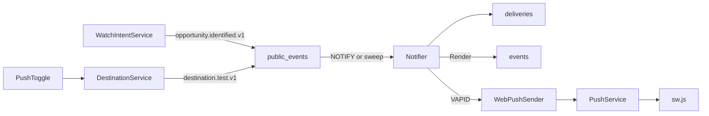
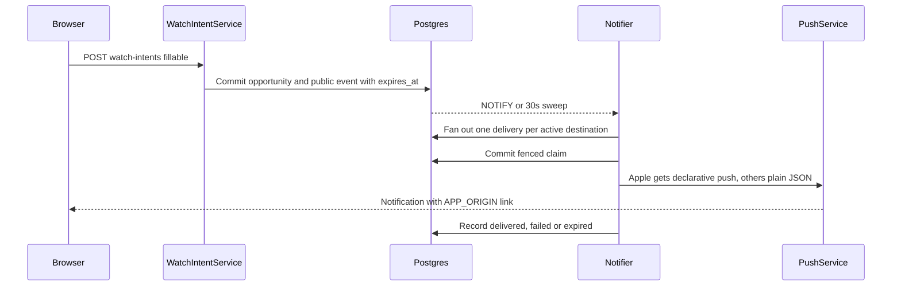
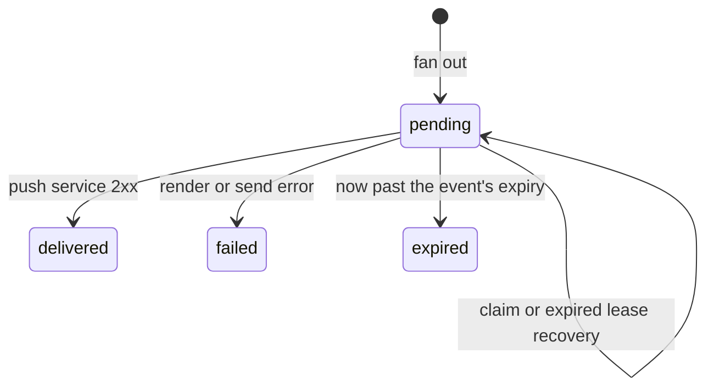
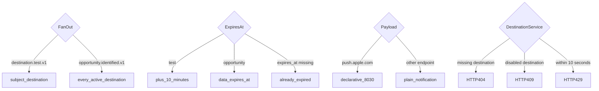
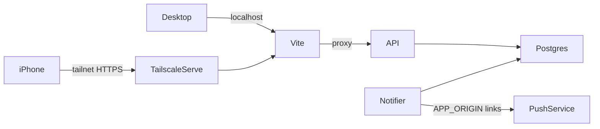

# Web Push
> Register desktop and iPhone browsers, then deliver a test notification through the public outbox.

<!-- ff:high-level -->
## High level
> Two producers write the public outbox; the Go notifier fans out, renders and sends.

<!-- /ff -->

<!-- ff:data-flow -->
## Data flow
> Opportunity path. The test path is the same from public_events on, aimed at one destination.

<!-- /ff -->

<!-- ff:state -->
## Delivery state
> A claim changes lease/token fields while status stays pending. Delivered means push-service acceptance.

<!-- /ff -->

<!-- ff:decisions -->
## Routing and guards
> Fan-out, expiry and payload shape are per event type and endpoint; the API guards test requests.

<!-- /ff -->

<!-- ff:dependencies -->
## Device access and dependencies
> Tailscale Serve provides private HTTPS access to the app. PushService delivers notifications separately.

| Dependency | Current behavior |
|---|---|
| Desktop access | Open `http://localhost:5173` or the `ts.net` URL; enable notifications in that browser. Each origin is its own subscription, so using both means two notifications per opportunity. |
| iPhone access | Same tailnet as Mac; MagicDNS and HTTPS certificates enabled; `tailscale serve --bg 5173`. Open printed HTTPS URL in Safari, Share → Add to Home Screen, launch OddsCafe, enable notifications. |
| `APP_ORIGIN` | Notifier only, required. Absolute origin that notification links open, e.g. `https://<mac>.<tailnet>.ts.net`. Compose defaults to `http://localhost:$FRONTEND_PORT`. |
| Browser permission | User tap grants permission; service worker registers and subscription is stored through `POST /destinations/web-push`. |
| VAPID | Existing keys stay stable. API gets public key; only notifier gets private key. Sender strips configured `mailto:` prefix before webpush-go adds it. |
| Persistence | `destinations` stores endpoint and encryption keys; public responses omit keys. `public_events` stores CloudEvents. Unique event/destination pair prevents duplicate delivery rows. |
| Expiry | Test: 10 minutes. Opportunity: `data.expires_at` = created_at + opportunity TTL (720 min default). Events without `expires_at` expire unsent. |
| Payload | Apple endpoints: Declarative Web Push (`web_push: 8030`, `navigate`), opened by iOS 18.4+ without the service worker. Others: `{title, body, url, tag}`, shown by `sw.js`. Max 3993 bytes. |
| Display | Opportunity: title `Away @ Home`, body `Selection price @ book · target price · fillable`, tap opens `/?event=<id>&opportunity=<id>`. The app does not read those params yet (#71). |
| Worker | 30-second sweep, 60-second lease, fresh claim token; stale results cannot overwrite a newer claim. `dispatched_at` means fan-out completed. |
| Runtime | Mac must remain awake and online, with app and notifier running. After a branch switch, rebuild the notifier image (`just refresh` once #84 lands). |
| Current scope | Test and opportunity notifications are delivered. Retries/backoff and dead-subscription handling are #73. |
| Manual validation | 2026-10-26: opportunity notification delivered to Mac and iPhone; iPhone cold-launch tap opened the Home Screen app (#72). |
| Operator commands | See [Web Push runbook](../../runbooks/web-push.md). Run repo commands from repository root. |
<!-- /ff -->

## Notes

