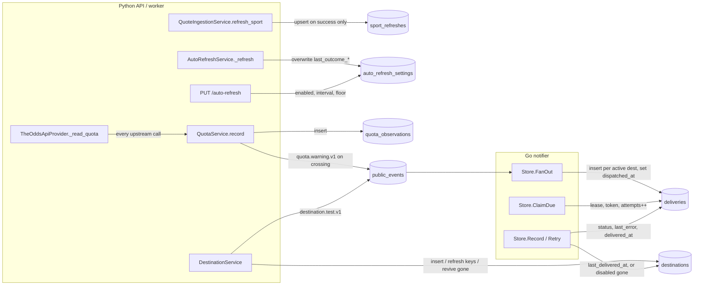

# Admin data inventory: what refresh, quota and delivery rows hold today

Research for #91 (part of the Admin view map, #90). Snapshot of `development` at
`0ea0490` (after #88 quota warning and #89 delivery resilience).

**Question.** What do the stored rows behind the Admin view hold today, and what is
missing for each planned panel?

**Short answer.** Today the tables hold *current state*, not *history*, for refresh;
quota has history but no attribution; deliveries have history but no read API, no
terminal timestamp for failures and no indexes for a log. Device list and the
credits meter are already served. Everything else needs new columns, a new table,
indexes or a read API.

All sources are in-repo. Paths are relative to the repo root.

---

## 1. Who writes what

---

## 2. Table inventory

### 2.1 `sport_refreshes`

| Column | Type | Notes |
|---|---|---|
| `sport_key` | varchar(64) PK | provider key, e.g. `basketball_nba` |
| `last_refreshed_at` | timestamptz not null | |

- **Writer.** `QuoteIngestionService.refresh_sport` calls `record_sport_refreshed`
  (upsert) only after every event in the pull persisted
  (`backend/app/application/quote_ingestion_service.py`,
  `backend/app/infrastructure/persistence/quote_ingestion_uow.py`). Manual
  `POST /ingestion/quotes/refresh-sport` and the Auto-Refresh worker both go through it.
- **Not written:** a failed or refused sport pull; per-event refresh
  (`POST /ingestion/quotes/refresh`) never touches it (schema comment in
  `backend/app/infrastructure/persistence/schema.py`).
- **Reader.** `SqlAlchemyAutoRefreshUnitOfWork.get_sport_refresh_times` feeds the
  cadence engine (cooldown is derived, ADR-016).
- **Retention / growth.** One row per sport, overwritten. Bounded by the catalog
  (`SPORT_LEAGUE_MAP`, 7 keys today). **No history.**
- **Indexes.** PK only.
- Migration: `backend/db/migrations/versions/20261027_0012_auto_refresh.py`.

### 2.2 `auto_refresh_settings`

| Column | Type | Notes |
|---|---|---|
| `id` | int PK | `CHECK id = 1`, single row, not seeded; absent row = defaults |
| `enabled` | bool | default false |
| `interval_minutes` | int | default 5, `CHECK 1..60` |
| `quota_floor` | int null | null = derived 10% of plan (`QuotaEngine.floor`) |
| `last_outcome_sport` | varchar(64) null | |
| `last_outcome_status` | varchar(16) null | `succeeded` / `failed` |
| `last_outcome_at` | timestamptz null | |
| `last_outcome_events_refreshed` | int null | |
| `last_outcome_error` | text null | |
| `updated_at` | timestamptz | stamped by `save_settings` only |

- **Writers.** `PUT /auto-refresh` -> `AutoRefreshService.update_settings` ->
  `save_settings` (settings columns). The worker's `AutoRefreshService._refresh` ->
  `record_outcome` after **each** sport it pulls, carrying settings over unchanged
  (`backend/app/infrastructure/persistence/auto_refresh_uow.py`).
- **Not written:** manual refreshes (success or failure) never record an outcome.
  A cycle that refreshes several sports keeps only the last one's outcome.
  `record_outcome` does not bump `updated_at`.
- **Retention / growth.** One row forever. **No history.**
- **Indexes.** PK only (none needed).

### 2.3 `quota_observations`

| Column | Type | Notes |
|---|---|---|
| `id` | serial PK | insertion order = observation order (written under `pg_advisory_xact_lock`) |
| `remaining` | int null | null until anything reported it |
| `used` | int null | |
| `source` | varchar(16) | `CHECK IN ('headers','local')` |
| `out_of_credits` | bool | |
| `observed_at` | timestamptz not null | app clock |

- **Writer.** Every upstream call: `TheOddsApiProvider._read_quota` builds a
  `QuotaReading` and hands it to `QuotaService.record`, which locks, derives the
  observation (`QuotaEngine.observe`: headers, else previous minus local
  `markets x regions`), inserts it, and stages `oddsengine.quota.warning.v1` on a
  floor crossing in the same transaction
  (`backend/app/infrastructure/odds_api_provider.py`,
  `backend/app/application/quota_service.py`, `backend/app/engines/quota_engine.py`).
  Covers sport pulls, single-event pulls, refused calls and the free `GET /v4/sports`
  balance check while paused.
- **Dropped on the way in.** The provider knows the `sport` and the call's actual
  cost (`x-requests-last` -> `UpstreamQuota.credits_spent`) but `QuotaReading` /
  the table carry neither; they only reach logs (`odds_api.quota`,
  `sport_refresh.completed`). No call kind (sport / event / balance check) and no
  trigger (manual / auto).
- **Reader.** Only the latest row (`ORDER BY id DESC LIMIT 1`) via
  `QuotaService.status`.
- **Retention / growth.** Append-only, never pruned. Roughly one row per paid call
  (~170/month on a 500-credit plan at 3 credits/call) plus at most one balance check
  per interval while paused (worst case ~8.6k/month at 5 min). Small.
- **Indexes.** PK only. No index on `observed_at`; a time-window chart would either
  scan or rely on `id` order as a proxy.
- Migration: `20261104_0013_quota_observations.py`.

### 2.4 `destinations`

| Column | Type | Notes |
|---|---|---|
| `id` | varchar(36) PK | |
| `channel` | varchar(32) | `web_push` today |
| `label` | varchar(128) | default "Browser" |
| `address` | text | push endpoint; `UNIQUE(channel, address)` |
| `config` | json | Web Push keys; never returned by the API |
| `created_at` | timestamptz | |
| `last_delivered_at` | timestamptz null | stamped by notifier on `delivered` ("convenience only") |
| `disabled_at` | timestamptz null | |
| `disabled_reason` | varchar(32) null | `user_removed` / `gone` |

- **Writers.** `DestinationService.register_web_push` (insert, or refresh keys and
  revive a `gone` row). Notifier `Store.Record`: `last_delivered_at` on delivered;
  `disabled_at`/`disabled_reason='gone'` on 404/410
  (`services/notifier/internal/store/store.go`).
- **Gap noted in passing.** `user_removed` exists in the enum
  (`backend/app/domain/destinations.py`) but no API route writes it; there is no
  `DELETE /destinations/{id}`.
- **Retention / growth.** Soft-disabled, never deleted. One row per browser.
- **Indexes.** PK, `uq_destinations_channel_address`.

### 2.5 `deliveries`

| Column | Type | Notes |
|---|---|---|
| `id` | varchar(36) PK | |
| `event_id` | FK `public_events.id` | |
| `destination_id` | FK `destinations.id` | |
| `status` | varchar(16) | `pending` / `delivered` / `gone` / `failed` / `expired` |
| `attempts` | int | incremented at claim, not at send |
| `next_attempt_at` | timestamptz | last scheduled retry time |
| `locked_until`, `claim_token` | | lease fencing (ADR-015) |
| `delivered_at` | timestamptz null | set only on `delivered`; `CASE` nulls it otherwise |
| `last_error` | text null | latest reason; cleared to null on `delivered` |
| `created_at` | timestamptz | fan-out time |

- **Writers (Go only).** `FanOut` inserts one row per active destination (or one for
  the subject destination on `destination.test.v1`), idempotent on
  `UNIQUE(event_id, destination_id)`. `ClaimDue` sets lease, token, `attempts+1`.
  `Record` writes terminal status; `Retry` reschedules with backoff (10s doubling,
  15 min cap). Retry past the event's expiry becomes `expired`; `gone` also flips
  every other pending delivery for that destination to `gone`
  (`services/notifier/internal/notifier/notifier.go`).
- **No terminal timestamp for non-success.** `failed` / `expired` / `gone` rows
  have no "finished at"; only `created_at` and the stale `next_attempt_at`. No
  per-attempt history: one `last_error`, wiped on a later success.
- **Python reads.** None. No persistence or API code reads `deliveries`.
- **Retention / growth.** Append-only, never pruned. Rows = delivered public events
  x active destinations at fan-out.
- **Indexes.** PK, `uq_deliveries_event_destination` (leads with `event_id`),
  partial `ix_deliveries_due (next_attempt_at) WHERE status='pending'`. **No index
  on `destination_id`** (Postgres does not index FKs), `created_at`, or non-pending
  `status`.
- Migration: `20261018_0011_deliveries.py`.

### 2.6 `public_events` (join target for deliveries)

| Column | Type | Notes |
|---|---|---|
| `id` | varchar(36) PK | CloudEvent id |
| `type` | varchar(128) | e.g. `oddsengine.opportunity.identified.v1` |
| `payload` | json | full CloudEvent envelope; `subject`, `time`, `data` inside |
| `created_at` | timestamptz | |
| `dispatched_at` | timestamptz null | fan-out complete (not "delivered") |

- **Writers.** Python, in domain transactions (ADR-014): watch-intent UoW
  (`opportunity.identified.v1`), quota UoW (`quota.warning.v1`), destination UoW
  (`destination.test.v1`). Notifier sets `dispatched_at`. Insert trigger
  `NOTIFY public_events`.
- **Retention / growth.** Append-only, never pruned. Types the notifier does not
  know stay undispatched forever.
- **Indexes.** PK, partial `ix_public_events_undispatched (created_at) WHERE
  dispatched_at IS NULL`. No index on `type`; `latest_test_requested_at` already
  filters on `type` + `payload->>'subject'` unindexed.
- **Useful for a log.** `type` gives the event kind; `payload.data` gives display
  text (opportunity selection/price, quota remaining/floor). Every delivery row
  can join to it on `event_id`.

### 2.7 Not a substitute: `workflow_events`

`QuotesRefreshed` rows exist per event per successful refresh, but carry no sport,
cost or outcome, are keyed per event (each event in a sport pull gets its own
`refresh_id`) and are never written on failure. Not usable as a refresh log.

---

## 3. What the existing read APIs already return

**`GET /auto-refresh`** (`backend/app/api/auto_refresh_schemas.py`
`AutoRefreshResponse`):

| Field | Source |
|---|---|
| `enabled`, `interval_minutes`, `quota_floor` | settings row |
| `last_outcome {sport, status, at, events_refreshed, error}` | last **worker** outcome only |
| `paused` | `QuotaEngine.is_paused(latest)` |
| `quota {remaining, used, floor (in force), source, observed_at}` | latest observation; `out_of_credits` not exposed |

**`GET /destinations`** (`backend/app/api/destination_schemas.py`
`DestinationResponse`): `id, channel, label, address, active, created_at,
last_delivered_at, disabled_at, disabled_reason`. No secrets, no failure counts.

---

## 4. Panel -> data map

Legend: **Covered** = served by an API today. **Stored** = in a table, needs a read
API. **Gap** = data does not exist.

| Panel / field | Status | Where it would come from | Gap |
|---|---|---|---|
| **Refresh log** (Systems) | | | |
| sport | Gap | `sport_refreshes` keeps latest per sport only | No refresh history table |
| cost (credits) | Gap | `credits_spent` parsed from `x-requests-last`, logged only | Not persisted anywhere |
| outcome (ok / failed / out of credits) | Gap | worker's last outcome only, overwritten | Failures and manual refreshes never stored |
| time | Gap | `sport_refreshes.last_refreshed_at` (latest success only) | No per-refresh rows |
| trigger (manual / auto), events refreshed | Gap | `last_outcome_events_refreshed` for the last worker refresh only | Not stored per refresh |
| **Quota history chart** (Credits) | Stored | `quota_observations` (`remaining`, `used`, `observed_at`) | Read API; index on `observed_at` (or page by `id`) |
| **Burn per sport** (Credits) | Gap | observation rows have no sport, no cost | `sport` and per-call `cost` on observations (or a refresh log with cost); `used` deltas break at monthly reset |
| **Credits vs floor** | Covered | `GET /auto-refresh` `quota.remaining`, `quota.floor` | none |
| **Delivery log incl. failures** (Systems) | Stored | `deliveries` JOIN `public_events` (type, payload) JOIN `destinations` (label) | Read API; terminal timestamp for failed/expired/gone; index for time-ordered and by-status reads; `last_error` lost on later success |
| **Device list with last delivered time** (Controls) | Covered | `GET /destinations` `last_delivered_at`, `disabled_reason` | Optional: last failure / recent failure count per device (derivable from deliveries, needs `destination_id` index) |
| Remove a device | Gap | `user_removed` enum exists | No write route sets it |
| **Health inputs** | | | |
| last refresh outcome / age | Partial | `GET /auto-refresh` `last_outcome.at/status` | Worker-only; manual refresh outcomes invisible; only last sport of a cycle |
| credits vs floor | Covered | `GET /auto-refresh` | none |
| paused | Covered | `GET /auto-refresh` `paused` | none |
| failed / expired deliveries | Stored | `deliveries.status` | Read API or aggregate; no time-of-failure column to window "recent"; no status index |
| gone destinations | Covered | `GET /destinations` `disabled_reason = gone`, `disabled_at` | none |
| out-of-credits flag | Stored | `quota_observations.out_of_credits` | Not exposed by `GET /auto-refresh` (only folded into `paused`) |

---

## 5. Gap list

1. **No refresh history.** `sport_refreshes` and `auto_refresh_settings.last_outcome_*`
   are overwrite-in-place. A refresh log (sport, cost, outcome, time, trigger) needs a
   new append-only table written by `refresh_sport` (and probably per-event refresh)
   on success *and* failure.
2. **Manual refresh outcomes are never recorded.** Only the worker writes
   `last_outcome_*`; a failed manual pull leaves no row.
3. **Per-call cost and sport are dropped.** `x-requests-last` and the sport are known
   in `TheOddsApiProvider._read_quota` but not carried in `QuotaReading` or stored in
   `quota_observations`. Burn per sport is impossible without them.
4. **No call kind / trigger on quota observations** (sport pull, event pull, free
   balance check; manual vs auto).
5. **No read API for quota history** and no `observed_at` index (`id` order is a
   usable proxy).
6. **No read API for deliveries.** Python has no persistence code for the table at all.
7. **Failed / expired / gone deliveries have no completion timestamp**, and
   `last_error` is single-valued and cleared on a later success. A failure log can
   only sort by `created_at`.
8. **Missing indexes for admin reads:** `deliveries(destination_id)`,
   `deliveries(created_at)` / `(status, created_at)`, `public_events(type)`,
   `quota_observations(observed_at)`.
9. **No retention policy** on `quota_observations`, `deliveries`, `public_events`
   (all append-only, never pruned). Growth is small at single-operator scale but a
   paged API is needed rather than unbounded lists.
10. **`out_of_credits` is not exposed** by `GET /auto-refresh` (only via `paused`).
11. **No way to set `user_removed`** on a destination from the API.

---

## Sources

- Migrations: `backend/db/migrations/versions/20261018_0009_public_events_outbox.py`,
  `20261018_0010_destinations.py`, `20261018_0011_deliveries.py`,
  `20261027_0012_auto_refresh.py`, `20261104_0013_quota_observations.py`
- Schema mirror: `backend/app/infrastructure/persistence/schema.py`
- Persistence: `auto_refresh_uow.py`, `quota_uow.py`, `destination_uow.py`,
  `quote_ingestion_uow.py` under `backend/app/infrastructure/persistence/`
- Writers: `backend/app/application/auto_refresh_service.py`, `quota_service.py`,
  `quote_ingestion_service.py`, `destination_service.py`;
  `backend/app/infrastructure/odds_api_provider.py`;
  `backend/app/engines/quota_engine.py`
- Notifier: `services/notifier/internal/store/store.go`,
  `internal/notifier/notifier.go`, `internal/events/events.go`,
  `internal/config/config.go`
- API: `backend/app/api/auto_refresh_schemas.py`, `destination_schemas.py`,
  `destination_router.py`, `quote_ingestion_router.py`
- Intent: `docs/adr/0014-*`, `0015-*`, `0016-*`
